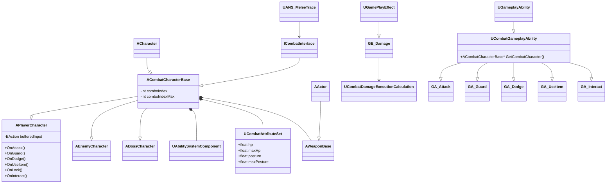

# クラス関連図

## 要素の洗い出しと機能のマッピング

| No | 役割            | 種別    | クラス/UEの機能                                                                                                                                                        |
|----|---------------|-------|------------------------------------------------------------------------------------------------------------------------------------------------------------------|
| 1  | キャラクタ共通の基底クラス | クラス   | ACharacterを継承してACombatCharacterBase派生クラスを作成                                                                                                                      |
| 2  | プレイヤー         | クラス   | ACombatCharacterBaseを継承してAPlayerCharacter派生クラスを作成                                                                                                                |
| 3  | 敵             | クラス   | ACombatCharacterBaseを継承してAEnemyCharacter派生クラスを作成                                                                                                                 |
| 4  | ボス            | クラス   | ACombatCharacterBaseを継承してABossCharacter派生クラスを作成                                                                                                                  |
| 5  | 刀             | クラス   | AActorを継承してAWeaponBase派生クラスを作成                                                                                                                                   |
| 6  | 攻撃            | 処理    | 攻撃処理をGameplayAbilityでGA_Attackを作成 衝突判定(UANS_MeleeTraceを作成) 衝突時に体力・体幹ダメージ付与(GameplayEffectでGE_Damageを作成 + C++の専用計算クラス(UCombatDamageExecutionCalculation)) |
| 7  | 弾き            | 処理    | 防御側キャラの弾き処理(GameplayAbilityでGA_Guardを作成) /攻撃側キャラの弾かれ処理(UANS_MeleeTrace内で処理)                                                                                  |
| 8  | ガード           | 処理    | 防御側キャラの弾き処理(GameplayAbilityでGA_Guardを作成) /攻撃側キャラの対ガード処理(UANS_MeleeTrace内で処理)                                                                                 |
| 9  | 回避            | 処理    | 防御側キャラの回避処理(GameplayAbilityでGA_Dodgeを作成) /攻撃側キャラの対無敵処理(UANS_MeleeTrace内で処理)                                                                                  |
| 10 | アイテム使用        | 処理    | GameplayAbilityでGA_UseItemを作成                                                                                                                                    |
| 11 | インタラクト        | 処理    | GameplayAbilityでGA_Interactを作成                                                                                                                                   |
| 12 | 無敵中           | 状態    | GameplayTagにState.Combat.Invincibleを作成                                                                                                                           |
| 13 | 弾き中           | 状態    | GameplayTagにState.Combat.Parryingを作成                                                                                                                             |
| 14 | ガード中          | 状態    | GameplayTagにState.Combat.Guardingを作成                                                                                                                             |
| 15 | 体力            | パラメータ | AttributeSetでhp/maxHpを作成                                                                                                                                         |
| 16 | 体幹            | パラメータ | AttributeSetでposture/maxPostureを作成                                                                                                                               |
| 17 | コンボ攻撃の最大数     | パラメータ | ACombatCharacterBaseのメンバー                                                                                                                                        |
| 18 | コンボ攻撃の現在の数    | パラメータ | ACombatCharacterBaseのメンバー                                                                                                                                        |
| 19 | 攻撃ボタン         | イベント  | EnhancedInputでIA_Attackを作成 /プレイヤー側で攻撃リクエストをハンドリング                                                                                                            |
| 20 | 防御ボタン         | イベント  | EnhancedInputでIA_Guardを作成 /プレイヤー側で防御リクエストをハンドリング                                                                                                             |
| 21 | 回避ボタン         | イベント  | EnhancedInputでIA_Dodgeを作成 /プレイヤー側で回避リクエストをハンドリング                                                                                                             |
| 22 | アイテム使用ボタン     | イベント  | EnhancedInputでIA_UseItemを作成 /プレイヤー側でアイテム使用リクエストをハンドリング                                                                                                       |
| 23 | ロックオンボタン      | イベント  | EnhancedInputでIA_Lockonを作成 /プレイヤー側でロックオンリクエストをハンドリング                                                                                                         |
| 24 | インタラクトボタン     | イベント  | EnhancedInputでIA_Interactを作成 /プレイヤー側でインタラクトリクエストをハンドリング                                                                                                      |
| 25 | 先行入力          | 処理    | プレイヤー側で入力をバッファし、各モーション上にAnimationNotifyStateを配置し、バッファ内容をハンドリング                                                                                                   |
| 26 | キャンセル         | 処理    | モーションのAnimationMontage上にAnimationNotifyStateのANS_CancelWIndowを作成し、バッファ内容を条件付きでハンドリング ICombatInterfaceクラスを作成し、キャラに継承させて、ハンドリングさせる                             |

## クラス関連図

